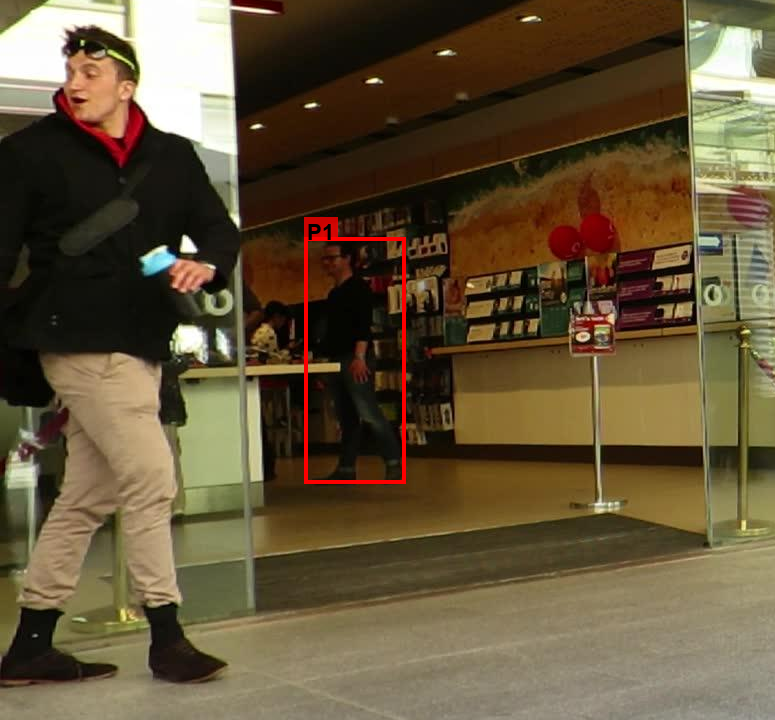
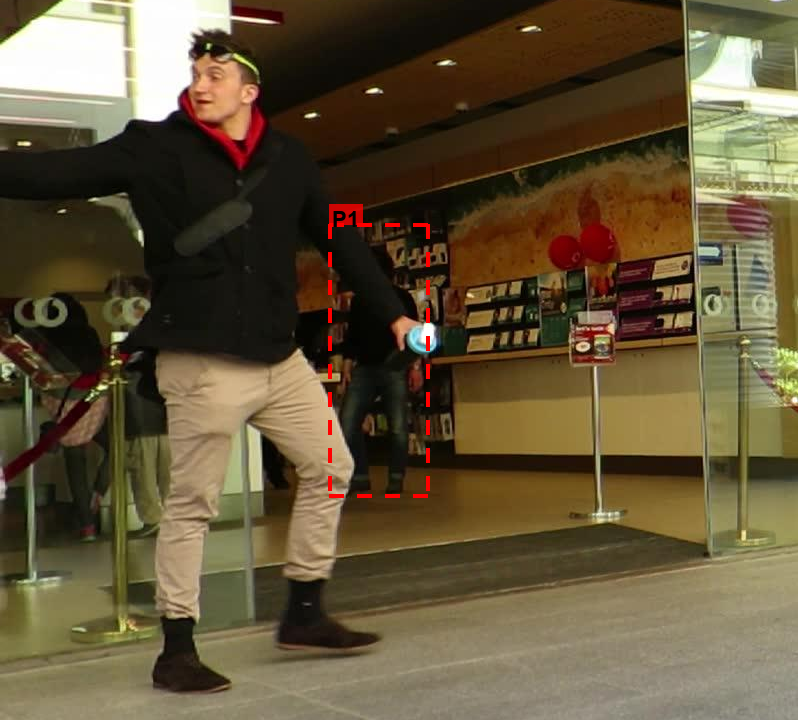
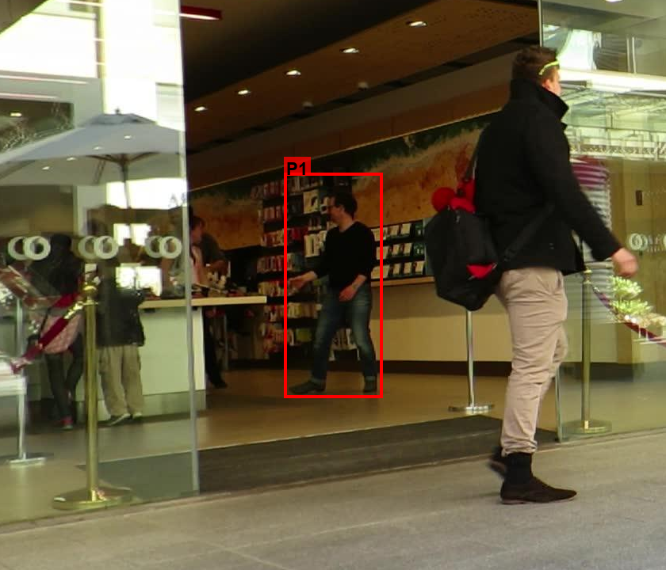

# Báo cáo cá nhân — Thạch Trung Đức

Đoạn video: MOT17-09, 150 frame (frame 1–150), nguồn MOTChallenge, giấy phép CC BY-NC-SA 3.0.

> **Quy ước frame:** báo cáo dùng số frame **theo CVAT** (0–149) cho khớp `src/check_submission.py`.
> Trong `gt/gt.txt`, `frame_id` = frame CVAT + 1.

## 0. Thông tin học viên

- Họ tên: Thạch Trung Đức
- MSSV: 2A202603141
- Mã đề (A/B/C): **B** (5 người: P1–P5, ID gốc MOT17-09: 1, 19, 20, 21, 22)
- Email: thachduc1201@gmail.com
- Link repository: https://github.com/ThachDuc123/K5-L2-DAY05-2A202603141-ThachTrungDuc--MOTTracking
- Giờ bắt đầu: `________` (giờ GMT+7 ngày làm lab)
- Giờ kết thúc: `________`

## 1. Xem trước đoạn video (CP0)

Ghi **trước khi vẽ**. Tên P1–P5 theo bảng nhận diện `.lab-local/de-B-P1-P5.jpg`; trong báo cáo, **P1 = track 1**, **P2 = track 2**, … (thứ tự track xuất trong file MOT 1.1).

| Mã | Frame xuất hiện | Frame cuối thấy được | Rẽ / dừng / đổi tốc độ ở frame | Bị che ở frame | Ghi chú |
|---|---|---|---|---|---|
| P1 | 0 | 149 | Chậm lại nhẹ quanh frame 95–110 | **0–19, 30–59** (`occluded`) | Đi ngang qua giữa khung (x ≈ 300 → 520), qua trước cửa hàng |
| P2 | 0 | 149 | Tăng tốc sang trái từ frame ~105 | — | Đi từ mép phải (x ≈ 1790) sang trái (x ≈ 1210), giãn dần |
| P3 | 0 | 109 | Đi chậm, gần như đứng ở frame 45–105 | — | Đứng ở x ≈ 1340 rồi **ra khỏi khung sau frame 109** (`outside`) |
| P4 | 0 | 149 | Gần như đứng yên cả đoạn | **100–149** (`occluded`) | Đứng cố định x ≈ 1350–1380, bị người đi ngang che từ frame 100 |
| P5 | 40 | 149 | Đi đều, tốc độ ổn định | — | **Xuất hiện từ frame 40** ở mép phải (x ≈ 1850), đi sang trái |

Nhận xét chung: P1 và P2 đi ngược chiều nhau ở hai nửa khung; P3 đứng gần như bất động rồi ra khỏi khung; P4 đứng yên nên chỉ cần keyframe thưa; P5 chỉ có mặt từ frame 40.

## 2. Keyframe và thời gian (CP1, CP4)

Số keyframe và mật độ lấy từ kết quả `src/check_submission.py` (frame tính theo CVAT, 0–149).

| Mã | Số keyframe | Keyframe ở frame | Số frame có mặt | Keyframe / 100 frame | Thời gian (phút) | Chỗ khó |
|---|---:|---|---:|---:|---|---|
| P1 | 12 | 0, 20, 30, 60, 70, 80, 90, 100, 110, 120, 130, 140 | 150 | 8.0 | `___` | Đoạn che 30–59: box phải giữ amodal, không co theo phần thấy |
| P2 | 14 | 0, 20, 30, 40, 50, 60, 70, 80, 90, 100, 110, 120, 130, 140 | 150 | 9.3 | `___` | Cuối đoạn tăng tốc sang trái, box dễ chậm hơn người |
| P3 | 10 | 0, 20, 30, 40, 50, 60, 70, 80, 90, 100, 110 | 110 | 9.1 | `___` | Người đứng gần như bất động rồi ra khỏi khung: keyframe cuối ở frame 110 |
| P4 | 10 | 0, 20, 30, 40, 50, 60, 70, 80, 90, 100 | 150 | 6.7 | `___` | Bị che 100–149: giữ amodal box, chỉ chỉnh ở keyframe quanh đoạn che |
| P5 | 11 | 40, 50, 60, 70, 80, 90, 100, 110, 120, 130, 140 | 110 | 10.0 | `___` | Chỉ có từ frame 40, box phải bám ngay từ frame xuất hiện |
| **Tổng** | **57** | — | **670** | **8.5** | — | — |

Keyframe / 100 frame của cả bài = 57 ÷ 670 × 100 = **8,5**.

**Đặt keyframe nhiều nhất ở ai?** P2 (14 keyframe). P2 đi chéo và **tăng tốc rõ ở nửa sau** (x giảm nhanh dần: ~20 px/10 frame ở đầu → ~60 px/10 frame cuối), nên nếu để keyframe thưa thì box nội suy sẽ chậm hơn người và trôi dần về sau; ngoài ra P2 còn đổi hướng/đổi nhịp bước nên cần keyframe dày ở đoạn giữa và cuối. P1 đứng thứ hai (12 keyframe) vì quanh hai đoạn che cần keyframe sát mép đoạn che để box vào/ra đúng vị trí.

## 3. Đoạn bị che (CP2)

Người bị che: **P1** (track 1). Ngoài ra P4 (track 4) cũng bị che một phần từ frame 100–149 và được xử lý cùng cách.

| Mốc | Frame |
|---|---:|
| Bắt đầu bị che một phần (bật `occluded`) | **0** (đợt đầu 0–19) — đợt chính bắt đầu ở **30** |
| Mất hẳn (bật `outside`) | Không có frame nào (không bật `outside`) |
| Hiện lại (tắt `outside`) | Không áp dụng (không dùng `outside`) |
| Thấy rõ trở lại (tắt `occluded`) | **20** (sau đợt đầu) và **60** (sau đợt chính) |

- Thời gian khuất hẳn: **0 frame = 0 giây** (không bật `outside`).
- Tổng thời gian bị che một phần: **50 frame ≈ 1,67 giây** (đợt 1: 20 frame ≈ 0,67 s; đợt 2: 30 frame = 1,0 s).
- Quyết định: **giữ cùng ID** (P1 = track 1 suốt cả 150 frame), không tạo track mới.
- Lý do (3 câu theo `docs/GUIDELINE.md`):
  1. **Khuất bao lâu so với 60 frame:** mỗi đợt chỉ 20 và 30 frame, đều dưới ngưỡng 60 frame (2 giây) → theo quy ước lớp, giữ cùng track, cùng ID.
  2. **Ngoại hình có khớp không:** kích thước box hai bên đoạn che gần như không đổi (~100 × 250 px), cùng dáng đi và vị trí tương đối so với cửa hàng, nên chắc chắn là cùng một người.
  3. **Chỗ hiện lại có đúng hướng và tốc độ không:** sau khi hiện lại (frame 20 và 60) người tiếp tục đi đúng hướng cũ sang phải với tốc độ khớp quỹ đạo trước khi bị che; nếu tạo track mới thì box sẽ "nhảy" ID và tracker bị tính là đổi người.

Toàn bộ đoạn che giữ **cờ `occluded`** và **box amodal toàn thân** (không co box theo phần nhìn thấy), nên khi xuất MOT 1.1 các frame này **vẫn có dòng** trong `gt/gt.txt` (cột `visibility = 0`).

Ảnh chụp màn hình (được vẽ lại từ file xuất MOT 1.1 trên frame thật của MOT17-09; nguồn MOT17, MOTChallenge — Milan et al., 2016):


*Frame 20 — trước đợt che chính: P1 (khung đỏ) còn thấy rõ, `occluded` đang tắt.*


*Frame 32 — giữa đoạn che: P1 bị che một phần, viền box nét đứt thể hiện cờ `occluded`; box vẫn bao toàn thân (amodal).*


*Frame 60 — sau khi hiện lại: tắt `occluded`, P1 vẫn là **cùng track ID 1** (không tạo track mới).*

## 4. Tự review ID (CP3)

Lượt 1 theo người (đi ngược từ frame 149 về 0 trên CVAT, mỗi lượt chỉ nhìn một người), lượt 2 theo cảnh (nhảy 10 frame mỗi bước bằng `V`, nhìn cả 5 box mỗi màn). Kết quả `check_submission.py` cũng xác nhận: **0 [LỖI], 0 [CẢNH BÁO]** — không có dấu hiệu `id_switch`, `merge`, `drift` hay đoạn khuất quá 60 frame.

| Frame | Mã người | Loại lỗi | Mô tả một câu | Phát hiện ở lượt | Đã sửa? |
|---:|---|---|---|---|---|
| — | — | — | Đã kiểm hai lượt (theo người ngược 149 → 0, và theo cảnh nhảy 10 frame), không phát hiện lỗi ID còn sót trong file nộp | 1 & 2 | — |

Các chỗ từng dừng kiểm tra kỹ (không phải lỗi, ghi lại để đối chiếu):

| Frame | Mã người | Loại lỗi | Mô tả một câu | Phát hiện ở lượt | Đã sửa? |
|---:|---|---|---|---|---|
| 30–60 | P1 | (không lỗi) | Vào/ra đoạn che: box amodal khớp vị trí trước khi che và khớp quỹ đạo sau khi hiện lại, ID không đổi | 1 | — |
| 109–110 | P3 | (không lỗi) | P3 ra khỏi khung: `outside` bật đúng ở frame 110, không tắt sớm (không thành `lost`) | 2 | — |
| 100–140 | P2 | (không lỗi) | Đoạn tăng tốc cuối clip: tua từng frame, box không trôi chậm hơn người | 2 | — |
| 40 | P5 | (không lỗi) | P5 mới xuất hiện từ frame 40: keyframe đầu đặt đúng frame xuất hiện, không có box thừa ở frame 0–39 | 2 | — |

Tổng hợp số lỗi theo loại:

| `id_switch` | `fragmentation` | `lost` | `merge` | `false_track` | `drift` | `flag` |
|---:|---:|---:|---:|---:|---:|---:|
| 0 | 0 | 0 | 0 | 0 | 0 | 0 |

**Lỗi nào chỉ lượt 2 (theo cảnh) mới thấy, lượt 1 (theo người) không thấy?** Bài này không còn lỗi thật nào sau khi sửa, nhưng có 2 điểm chỉ lượt 2 mới xác nhận được: P3 đã rời khung từ frame 110 (lượt 1 đi ngược theo từng người chỉ thấy track P3 "kết thúc", lượt 2 nhìn cả cảnh mới chắc chắn khung không còn người đó và không thành `lost`) và P5 xuất hiện muộn ở frame 40 (lượt 1 không để ý vùng khung trống frame 0–39, lượt 2 mới khẳng định không có box thừa — không thành `false_track`). Lý do: lượt 1 chỉ tập trung một người nên bỏ qua phần khung không liên quan, còn `lost` / `false_track` là lỗi "so với cả cảnh" nên phải nhìn tổng thể mới thấy.

## 5. File xuất và kết quả tự kiểm (CP4)

| Kiểm tra | Kết quả |
|---|---|
| Tên file MOT 1.1 | `src/exports/ThachTrungDuc_mot.zip` |
| Tên file CVAT for video 1.1 | `src/exports/ThachTrungDuc_cvat_video.zip` |
| Số track ID khác nhau trong `gt/gt.txt` (phải là 5) | **5** |
| Frame `outside` không có dòng trong `gt.txt` (đúng / sai) | **Đúng** — P3 ra khỏi khung từ frame 110 trở đi, các frame đó không có dòng nào cho track 3 |
| Job đã completed trên CVAT máy cá nhân | **Đã chuyển sang completed** |

Dán phần tóm tắt in ra từ `src/check_submission.py`:

```text
Số frame in theo CVAT (bắt đầu từ 0). Trong gt.txt, frame_id = frame CVAT + 1.

=== File MOT 1.1: ThachTrungDuc_mot.zip ===
  Số track ID: 5   |   Tổng số box: 670
  [OK]        Đúng 5 track ID.

  Track | Frame có mặt | Số frame | Đoạn vắng (outside)
      1 |   0–149      |      150 | -
      2 |   0–149      |      150 | -
      3 |   0–109      |      110 | -
      4 |   0–149      |      150 | -
      5 |  40–149      |      110 | -


=== File CVAT for video 1.1: ThachTrungDuc_cvat_video.zip ===

  Track | Nhãn   | Frame thấy | Keyframe | KF/100 frame | Frame occluded | Lần bật outside
      0 | person |        150 |       12 |          8.0 |             50 |               0
              Track 0: keyframe ở frame [0, 20, 30, 60, 70, 80, 90, 100, 110, 120, 130, 140]
      1 | person |        150 |       14 |          9.3 |              0 |               0
              Track 1: keyframe ở frame [0, 20, 30, 40, 50, 60, 70, 80, 90, 100, 110, 120, 130, 140]
      2 | person |        110 |       10 |          9.1 |              0 |               1
              Track 2: keyframe ở frame [0, 20, 30, 40, 50, 60, 70, 80, 90, 100]
      3 | person |        150 |       10 |          6.7 |             50 |               0
              Track 3: keyframe ở frame [0, 20, 30, 40, 50, 60, 70, 80, 90, 100]
      4 | person |        110 |       11 |         10.0 |              0 |               0
              Track 4: keyframe ở frame [40, 50, 60, 70, 80, 90, 100, 110, 120, 130, 140]

  Tổng: 57 keyframe / 670 frame có mặt = 8.5 keyframe / 100 frame
  [OK]        Đọc được 5 track từ annotations.xml.

=== Tóm tắt ===
  Lỗi: 0   |   Cảnh báo: 0
  Đạt. Dán phần tóm tắt này vào báo cáo mục 5.
```

## 6. Ba câu kết

1. **Nếu được gán lại, bạn sẽ đặt keyframe khác ở đâu? Vì sao?**

   Sẽ thêm 1 keyframe ở **giữa đoạn che của P1 (khoảng frame 45)**: đây là khoảng giữa hai keyframe dài nhất của P1 (30 → 60, cách 30 frame), cả đoạn box amodal đều do nội suy nên nếu người hơi đổi tư thế/lệch vị trí trong lúc bị che thì cả 30 frame sẽ trôi cùng lúc — chèn 1 keyframe ở frame 45 chia đôi khoảng sai số. Ngoài ra sẽ dày thêm 1–2 keyframe cho **P2 quanh frame 100–140**: đây là chỗ tăng tốc rõ nhất (x giảm từ ~20 px/10 frame lên ~60 px/10 frame), nội suy tuyến tính giả định vận tốc không đổi nên càng về cuối box càng chậm hơn người; keyframe dày hơn sẽ bám sát thời điểm vận tốc thay đổi thay vì "trung bình hóa" cả đoạn.

2. **Có chỗ nào bạn không chắc "cùng ID hay ID mới"? Bạn đã quyết định và ghi chú thế nào?**

   Có — **P4 bị che từ frame 100 đến hết clip (frame 149)**, tức 50 frame, chỉ còn 10 frame nữa là chạm ngưỡng 60 frame của lớp. Nếu đoạn video dài hơn và người này khuất quá 60 frame thì phải tạo track mới theo quy ước. Tôi quyết định **giữ cùng ID** vì: (1) 50 frame < 60 frame; (2) box amodal giữ nguyên kích thước/vị trí đứng cố định, chắc chắn cùng người. Đã ghi quyết định và lý do vào mục 3 của báo cáo (P1 và P4 đều xử lý theo cách này). Trường hợp P1 (hai đợt che 20 và 30 frame) thì không lưỡng lự vì cách ngưỡng xa hơn.

3. **Một lỗi ID trong job của bạn có thể làm xe tự lái dự đoán sai chuyển động của người đó như thế nào? Lỗi đó ảnh hưởng MOTA hay IDF1 nhiều hơn?**

   Lấy ví dụ lỗi `id_switch` dễ xảy ra nhất trong job này: P1 bị che xong mà tạo track mới, hoặc box P1 nhảy sang người đi ngang qua. Khi đó tracker tính vận tốc giữa hai frame liên tiếp từ hai người khác nhau — ví dụ dịch chuyển 1,5 m trong 1/30 s tương đương **162 km/h** — xe tự lái sẽ dự đoán người này "phóng vọt" hoặc đổi hướng đột ngột rồi phanh/né sai chỗ, trong khi người thật đi đều. Ảnh hưởng **IDF1 nhiều hơn MOTA**: MOTA chủ yếu đo detection (cùng ví dụ trong `docs/MOT_FORMAT.md`: 4 lần đổi ID chỉ làm MOTA giảm ~0,02), còn IDF1 ghép cả track với cả track nên mỗi frame sau lỗi ID đều bị tính là giữ ID sai — lỗi một đoạn ngắn cũng làm IDF1 rơi rõ.

## Bonus (nếu làm)

Chưa làm bonus (ưu tiên hoàn thành CP0–CP4).

## 7. Tài liệu tham khảo và công cụ AI đã dùng

- MOTChallenge — MOT17 (Milan et al., 2016), giấy phép CC BY-NC-SA 3.0. Ảnh minh chứng: box vẽ theo tọa độ trong file xuất MOT 1.1 lên frame MOT17-09.
- CVAT Community — [MOT format](https://docs.cvat.ai/docs/dataset_management/formats/format-mot/), [CVAT for video format](https://docs.cvat.ai/docs/dataset_management/formats/format-cvat/).
- Tài liệu lab: `docs/GUIDELINE.md`, `docs/MOT_FORMAT.md`, `CHECKPOINTS.md`, `RUBRIC.md`, `SUBMISSION.md`.
- Công cụ: `src/check_submission.py` (tự kiểm file xuất), `src/setup_local_lab.py` (tạo task theo MSSV).
- **Trợ lý AI (ZCode):** dùng để tra định dạng MOT 1.1 / CVAT for video 1.1, thống kê số keyframe và đoạn `occluded` từ file xuất, và hỗ trợ soạn báo cáo theo dữ liệu xuất thật. Toàn bộ phần gán nhãn trên CVAT do sinh viên thực hiện.